<p align="center">
  <picture>
    <source media="(prefers-color-scheme: dark)" srcset="docs/readme/banner-94fc01f1.dark.png">
    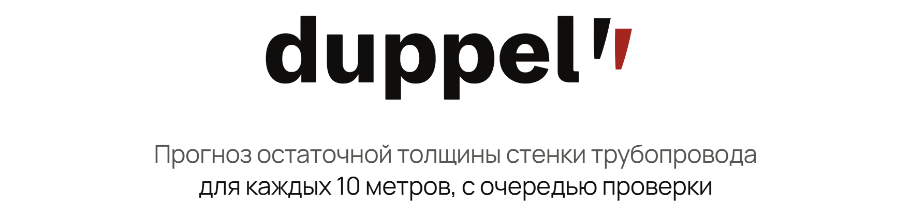
  </picture>
</p>

<p align="center">
  <!-- readme:buttons -->
  <a href="#запуск"><picture><source media="(prefers-color-scheme: dark)" srcset="docs/readme/cta-run-73268e12.dark.png"></picture></a>
  <a href="docs/README.md"><picture><source media="(prefers-color-scheme: dark)" srcset="docs/readme/cta-docs-d341d0ac.dark.png">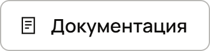</picture></a>
  <!-- /readme:buttons -->
</p>

<p align="center">
  <!-- readme:status -->
  <a href="docs/model.md"><picture><source media="(prefers-color-scheme: dark)" srcset="docs/readme/badge-status-1-9ea3b574.dark.png"></picture></a>
  <a href="docs/evidence.md"><picture><source media="(prefers-color-scheme: dark)" srcset="docs/readme/badge-status-2-c9ed7a52.dark.png"></picture></a>
  <br>
  <a href="#запуск"><picture><source media="(prefers-color-scheme: dark)" srcset="docs/readme/badge-status-3-b352af71.dark.png">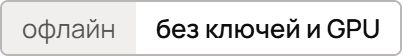</picture></a>
  <a href="docs/evidence.md"><picture><source media="(prefers-color-scheme: dark)" srcset="docs/readme/badge-status-4-49af1df7.dark.png"></picture></a>
  <a href="LICENSE"><picture><source media="(prefers-color-scheme: dark)" srcset="docs/readme/badge-status-5-0c39c5ab.dark.png"></picture></a>
  <!-- /readme:status -->
</p>

<p align="center">
  <!-- readme:stack -->
  <picture><source media="(prefers-color-scheme: dark)" srcset="docs/readme/badge-stack-1-06b9eef1.dark.png"></picture>
  <picture><source media="(prefers-color-scheme: dark)" srcset="docs/readme/badge-stack-2-50b67f5a.dark.png"></picture>
  <picture><source media="(prefers-color-scheme: dark)" srcset="docs/readme/badge-stack-3-9232d345.dark.png"></picture>
  <br>
  <picture><source media="(prefers-color-scheme: dark)" srcset="docs/readme/badge-stack-4-da1d0a09.dark.png"></picture>
  <picture><source media="(prefers-color-scheme: dark)" srcset="docs/readme/badge-stack-5-cb71276d.dark.png"></picture>
  <!-- /readme:stack -->
</p>

<p align="center">
  <!-- readme:nav -->
  <a href="#зачем"><picture><source media="(prefers-color-scheme: dark)" srcset="docs/readme/badge-nav-1-f3647272.dark.png">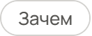</picture></a>
  <a href="#что-внутри"><picture><source media="(prefers-color-scheme: dark)" srcset="docs/readme/badge-nav-2-56c55329.dark.png">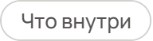</picture></a>
  <a href="#результаты"><picture><source media="(prefers-color-scheme: dark)" srcset="docs/readme/badge-nav-3-96e8d58a.dark.png"></picture></a>
  <a href="#запуск"><picture><source media="(prefers-color-scheme: dark)" srcset="docs/readme/badge-nav-4-e445d712.dark.png"></picture></a>
  <br>
  <a href="#как-устроено"><picture><source media="(prefers-color-scheme: dark)" srcset="docs/readme/badge-nav-5-e5ea898b.dark.png"></picture></a>
  <a href="#ограничения"><picture><source media="(prefers-color-scheme: dark)" srcset="docs/readme/badge-nav-6-329b6c6a.dark.png">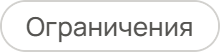</picture></a>
  <a href="#документация"><picture><source media="(prefers-color-scheme: dark)" srcset="docs/readme/badge-nav-7-e43726fd.dark.png">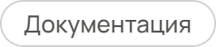</picture></a>
  <!-- /readme:nav -->
</p>

duppel прогнозирует **минимальную остаточную толщину стенки в каждом 10-метровом сегменте
трубопровода** на дату, когда диагностику не проводили, и показывает, какие участки проверять
первыми. На входе — паспорта труб, профиль трассы, суточный техрежим и отчёты внутритрубной
диагностики (ВТД). На выходе — прогноз с интервалом, очередь проверки и объяснение каждого сегмента
в миллиметрах. Всё работает на одной машине, без платных ключей и GPU.

<p align="center">
  <picture>
    <source media="(prefers-color-scheme: dark)" srcset="docs/images/inspect-863bb9d5.dark.png">
    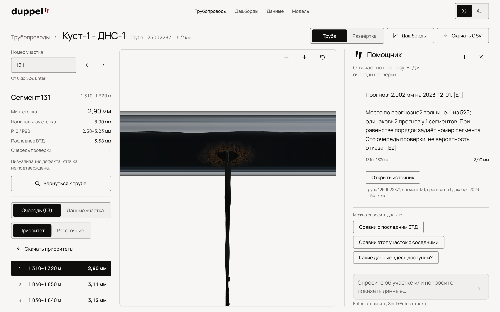
  </picture>
  <br>
  <sub>Осмотр трубы 1250022871: сегмент 131 первым в очереди проверки, прогноз 2,90 мм при номинале 8,00 мм. Помощник отвечает со ссылками на данные.</sub>
</p>

## Зачем

Промысловые трубопроводы чаще всего отказывают из-за внутренней коррозии, а ВТД проходит раз в
несколько лет и есть не у каждой трубы. Между обследованиями инженер не знает, где стенка уже
тонкая, а шурфы и ремонты планирует по старому отчёту. duppel отвечает на два вопроса:

| Ситуация | Что известно | Что даёт duppel |
| --- | --- | --- |
| **Между обследованиями** | Одно или несколько прошлых ВТД | Профиль толщины на новую дату: прошлый пропуск совмещается с сеткой, модели переносят его во времени |
| **С ввода в эксплуатацию** | Ни одного ВТД | Оценка уровня стенки и участков риска по рельефу, режиму и аналогам того же направления потока |

Цифры о масштабе проблемы с источниками собраны в [отдельном документе](docs/problem-context.md).

## Что внутри

**Список труб и карта сети.** Для каждой трубы — минимальная прогнозная стенка, число участков в
очереди проверки и дата последнего ВТД.

<p align="center">
  <picture>
    <source media="(prefers-color-scheme: dark)" srcset="docs/images/home-4af969dd.dark.png">
    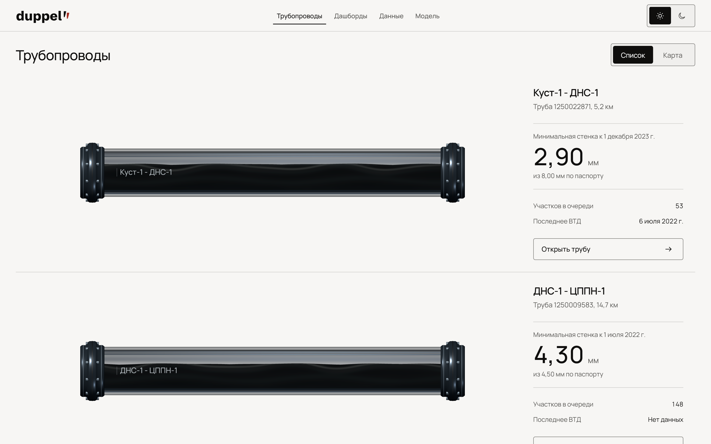
  </picture>
</p>

**Осмотр трубы.** 3D-труба, развёртка толщины и сечение связаны одним выбранным сегментом.
Слева паспорт сегмента и очередь проверки, справа помощник. Выбор хранится в адресе, поэтому любой
вид можно отправить ссылкой. Очередь выгружается в CSV.

<p align="center">
  <picture>
    <source media="(prefers-color-scheme: dark)" srcset="docs/images/unroll-93a197f5.dark.png">
    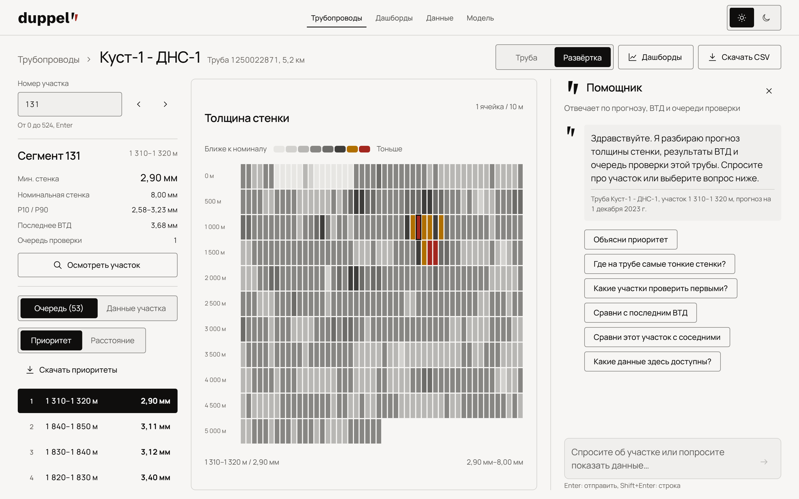
  </picture>
  <br>
  <sub>Развёртка: каждая ячейка — 10 м трубы, цвет — прогноз толщины от номинала до самого тонкого места.</sub>
</p>

**Дашборды.** Профиль толщины с интервалом P10–P90, базой сравнения, номиналом и браковочным
уровнем; разница с прошлым ВТД; очередь проверки. Блоки можно добавлять, переставлять и менять по
размеру, конфигурация сохраняется в браузере.

<p align="center">
  <picture>
    <source media="(prefers-color-scheme: dark)" srcset="docs/images/dashboards-2a975196.dark.png">
    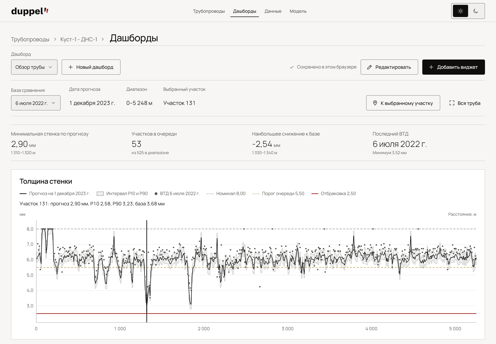
  </picture>
</p>

**Модель и валидация.** Рейтинг всех моделей и базовых решений на одних и тех же сегментах,
глобальная важность признаков, график «прогноз — наблюдение» по каждой точке валидации.

<p align="center">
  <picture>
    <source media="(prefers-color-scheme: dark)" srcset="docs/images/model-d3a65cdf.dark.png">
    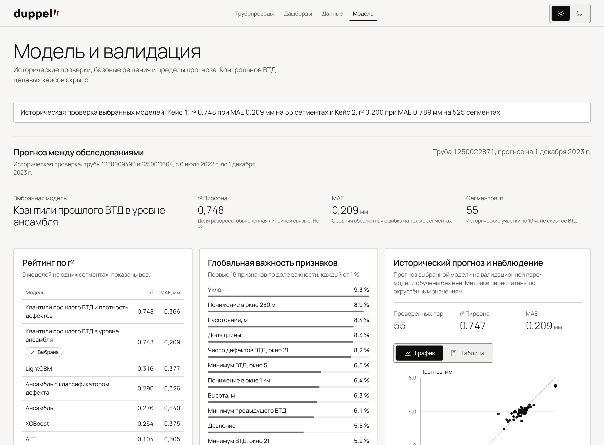
  </picture>
</p>

**Данные и качество.** Покрытие труб обследованиями, слои хранилища, карантин с причинами и
43 проверки качества с долей строк-отклонений.

<p align="center">
  <picture>
    <source media="(prefers-color-scheme: dark)" srcset="docs/images/data-b0f74f92.dark.png">
    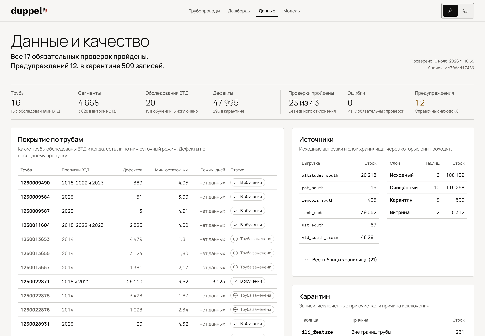
  </picture>
</p>

**На телефоне** доступны те же разделы.

<p align="center">
  <picture>
    <source media="(prefers-color-scheme: dark)" srcset="docs/images/phone-home-db708346.dark.png">
    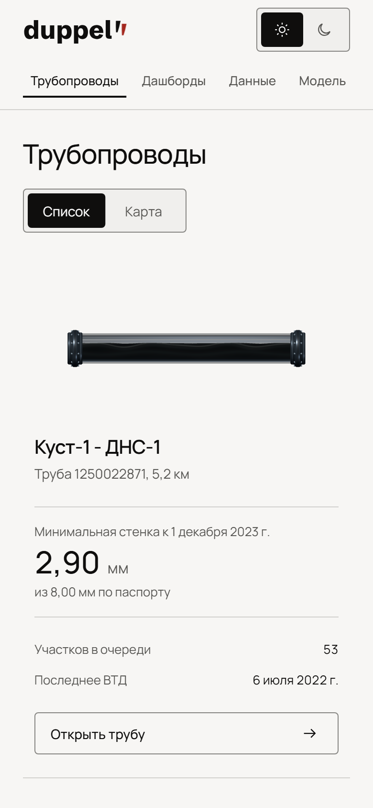
  </picture>
  <picture>
    <source media="(prefers-color-scheme: dark)" srcset="docs/images/phone-dashboards-951675f2.dark.png">
    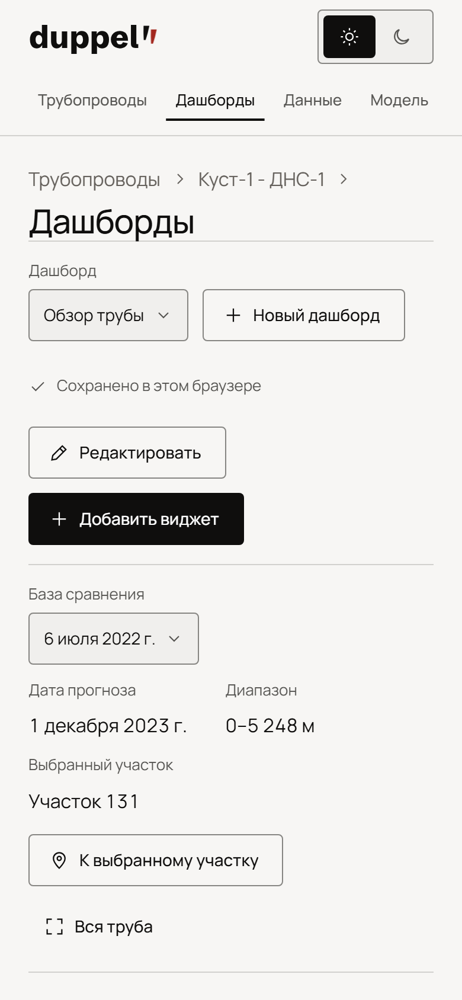
  </picture>
  <picture>
    <source media="(prefers-color-scheme: dark)" srcset="docs/images/phone-data-cb028ccf.dark.png">
    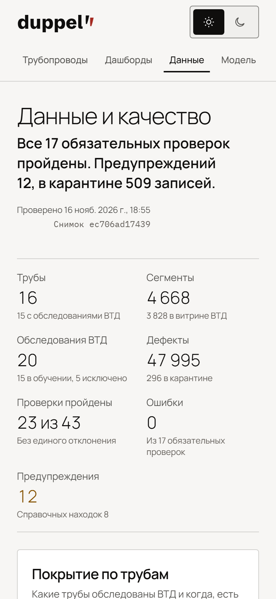
  </picture>
</p>

## Результаты

Контрольное ВТД на дату прогноза у целевых труб скрыто, поэтому каждый сценарий проверяется на
исторической паре с тем же устройством задачи. Модели учатся без этой пары и проверяются на ней.

| Сценарий | Валидационная пара | Сегментов | r² Пирсона | MAE, мм |
| --- | --- | --- | --- | --- |
| Между обследованиями | соседи по нитке 1250009490 и 1250011604: ВТД 2022 → ВТД 01.12.2023 | 55 | **0,748** | 0,209 |
| С ввода в эксплуатацию | труба 1250022871: ввод 2000 → первое ВТД 2018 | 525 | **0,200** | 0,789 |

Для сравнения: прошлое ВТД со сглаживанием даёт r² 0,008, «номинал минус скорость коррозии» — 0.
Полная таблица моделей, команды воспроизведения и границы этих чисел — в
[валидации](docs/evidence.md).

## Запуск

Нужны Docker и Docker Compose v2.

```bash
docker compose up --build -d --wait
```

Compose собирает образы, прогоняет конвейер (хранилище, признаки, обучение, прогноз) и поднимает
API и интерфейс. Откройте **http://localhost:8080**; схема API — http://localhost:8000/docs.

Пересчитать прогноз и забрать `result.csv`:

```bash
docker compose run --rm pipeline python -m pipetwin
docker compose restart backend
docker compose cp backend:/data/result.csv ./result.csv
```

Конвейер детерминирован: seed 42, версии закреплены в `ml/uv.lock`, повторный запуск даёт тот же
`result.csv` байт в байт. Настройки, запуск без Docker и проверки: [запуск](docs/running.md).

## Как устроено

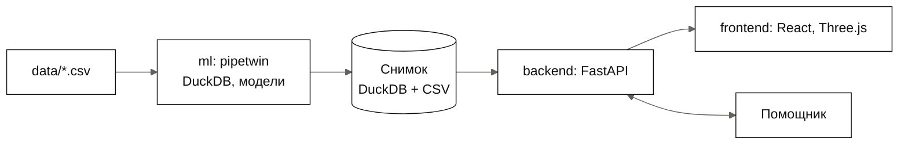

| Каталог | Что внутри |
| --- | --- |
| [`ml/`](ml) | Конвейер `pipetwin`: хранилище DuckDB raw → core → mart, 43 проверки качества, признаки, модели, прогноз, интерпретация |
| [`backend/`](backend) | API на FastAPI по Clean Architecture: проверяет полноту снимка и отдаёт его; инженерный помощник |
| [`frontend/`](frontend) | Интерфейс на React и TypeScript: 3D-труба на Three.js, дашборды, страницы данных и модели, светлая и тёмная темы |
| [`data/`](data) | Демо-набор: обезличенные выгрузки одного нефтяного месторождения |
| [`docs/`](docs/README.md) | Документация продукта |

**Модель для трубы с прошлым ВТД.** Форма профиля берётся из прошлого пропуска, совмещённого с
сеткой по сварным швам: квантили остаточной толщины и плотность дефектов вокруг сегмента. Уровень и
масштаб задаёт ансамбль LightGBM и XGBoost с вероятностью дефекта от классификатора; интервал —
конформный.

**Модель для трубы без ВТД.** Рельефный приор «будет ли дефект в сегменте» по уклонам, низинам и
подъёмам; уровень — номинал минус средняя скорость потери металла труб того же направления;
интервал — квантильный CatBoost.

Подробно: [как устроен прогноз](docs/model.md).

**Помощник** отвечает на вопросы о трубе и сегменте, каждое утверждение ссылается на данные. Без
языковой модели он даёт сводку по сегменту; с моделью строит таблицы, графики и дашборды через
ограниченный набор инструментов. [Подробнее](docs/assistant.md).

## Ограничения

- Точность на целевых трубах не измерена: их контрольное ВТД скрыто. На трубе с прошлым ВТД стоит
  ждать r² ниже валидационных 0,75, потому что сдвиг одометра там интерполируется по соседям.
- Для трубы без ВТД позиции дефектов слабо переносятся между трубами: прогноз — оценка уровня с
  осторожной формой, а не карта дефектов.
- Прогноз — минимум в сегменте 10 м, а не карта стенки по окружности. P10–P90 не откалиброваны по
  покрытию. Приоритет проверки — относительный порядок, а не вероятность отказа.

Полный список: [ограничения](docs/limitations.md).

## Документация

| Вопрос | Документ |
| --- | --- |
| Как пользоваться интерфейсом? | [Первые 15 минут](docs/guide.md) |
| Как устроен прогноз? | [Модель](docs/model.md) |
| Насколько ему можно верить? | [Валидация](docs/evidence.md) · [Ограничения](docs/limitations.md) |
| Как поставить у себя? | [Запуск](docs/running.md) · [Данные и безопасность](docs/security.md) |
| Как подключить свои данные или API? | [Данные](docs/data-contract.md) · [API](docs/api.md) · [Архитектура](docs/architecture.md) |

Все документы: [docs/README.md](docs/README.md).

---

<p align="center">
  <picture>
    <source media="(prefers-color-scheme: dark)" srcset="docs/readme/mark-2cfda5f0.dark.png">
    
  </picture>
  <br>
  <sub>Team GoatWhistle, 2026. Licensed under <a href="LICENSE">MIT</a>.</sub>
</p>
