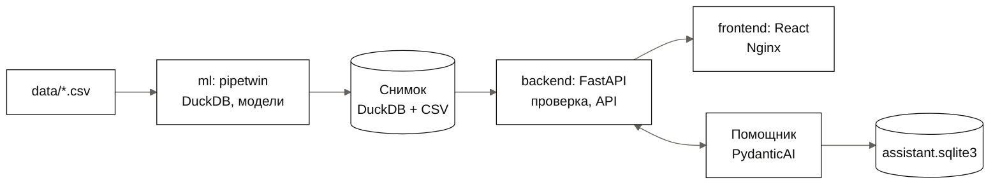

# Архитектура

Три части, связанные файлами снимка и HTTP: ML-конвейер считает прогноз, backend проверяет и
отдаёт его, интерфейс показывает. Обучение отделено от запуска приложения и от HTTP.

**Читайте, если** меняете код или встраиваете продукт в свою инфраструктуру · **Связано:**
[Запуск](running.md) · [Данные](data-contract.md) · [API](api.md)

---

## Как данные доходят до экрана?

| Часть | Каталог | Стек | Ответственность |
| --- | --- | --- | --- |
| Конвейер | `ml/` | Python 3.12, DuckDB, LightGBM, XGBoost, CatBoost, scikit-learn | Хранилище, признаки, обучение, прогноз, интерпретация |
| Backend | `backend/` | FastAPI, DuckDB, PydanticAI | Загрузка и проверка снимка, API, помощник |
| Интерфейс | `frontend/` | React, Vite, TypeScript, TanStack Query, Three.js | Осмотр трубы, данные, модель, дашборды |

## Как устроен backend?

Clean Architecture в `backend/src/app`:

| Слой | Ответственность |
| --- | --- |
| `domain` | Сетка сегментов, прогноз, полнота снимка, границы, ранжирование |
| `usecase` | Каталог снимка, сводки труб, профиль, признаки сегмента, экспорт, цикл помощника |
| `repository` | SQL к DuckDB, чтение CSV, хранилище артефактов помощника |
| `adapter` | Языковые модели, классификатор запросов, логирование |
| `controller` | Валидация HTTP, сериализация, ошибки, CSV |
| `main.py` | Сборка адаптеров и загрузка снимка при старте |

Внутренние слои не импортируют FastAPI и DuckDB; архитектурный тест
`tests/unit/architecture/test_dependency_rule.py` проверяет направление импортов.

## Что происходит при старте backend?

1. `Settings` читает `DATA_ROOT` и `STATE_ROOT`.
2. `DuckdbSnapshotSource` открывает хранилище только для чтения и читает CSV снимка.
3. `ForecastCatalog` проверяет покрытие, значения и совпадение с `result.csv`.
4. При успехе запросы получают неизменяемый снимок и его идентификатор.
5. При отказе `/ready` и продуктовые запросы возвращают 503; `/health` остаётся доступен.

## Как устроен интерфейс?

Feature-Sliced структура в `frontend/src`: `app` (маршруты и оболочка), `pages`, `features`
(3D-труба, карта сети, полоса сегментов, сравнение с валидацией, помощник, генератор виджетов), `entities` (запросы TanStack
Query и типы из OpenAPI), `shared` (дизайн-система, i18n, движение).

- Выбранная труба, сегмент, режим просмотра и диапазон хранятся в URL, поэтому любой вид можно
  открыть прямой ссылкой.
- Труба, развёртка и сечение рисуются в Three.js; без WebGL работают Canvas2D и SVG с теми же
  данными.
- Nginx раздаёт статику, прямые ссылки SPA и проксирует `/api/`. Данные не встраиваются в бандл.

---

[Документация](README.md) · [README проекта](../README.md)
