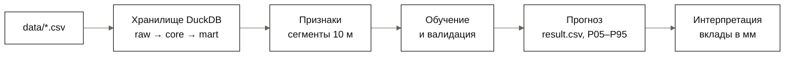

# Как устроен прогноз

Конвейер `python -m pipetwin` (пакет [`ml/src/pipetwin`](../ml/src/pipetwin)) превращает выгрузки
паспортов, профиля трассы, техрежима и отчётов внутритрубной диагностики (ВТД) в прогноз
минимальной остаточной толщины стенки каждого 10-метрового сегмента на заданную дату.

**Читайте, если** проверяете метод или хотите переобучить модели · **Связано:**
[Валидация](evidence.md) · [Ограничения](limitations.md) · [Данные](data-contract.md)

---

## Какие задачи решает модель?

| Сценарий | Код | Что известно о трубе | Пример в демо-наборе |
| --- | --- | --- | --- |
| Между обследованиями | `case1` | Одно или несколько прошлых ВТД | Труба 1250022871, 5,25 км, 219×8; ВТД 2018 и 06.07.2022; прогноз на 01.12.2023 |
| С ввода в эксплуатацию | `case2` | Ни одного ВТД, только паспорт, трасса и режим | Труба 1250009583, 14,75 км, 219×4,5; прогноз на 01.07.2022 |

## Из каких шагов состоит конвейер?

1. **Хранилище** ([`ml/warehouse`](../ml/warehouse/README.md)). CSV загружаются в DuckDB слоями
   raw → core → mart. Отбракованные строки уходят в `quarantine` с причиной, 43 проверки качества
   пишутся в `dq.check_result`. Модель читает только очищенный слой `core`.
2. **Признаки** (`features.py`, `align.py`). Труба режется на сегменты по 10 м
   (`segment_id = floor(Distance / 10)`), цель — минимум остаточной толщины в сегменте. Пропуски
   ВТД переводятся в координаты профиля трассы: одометр снаряда между пропусками расходится на
   1–8 м, почти на целый сегмент. Признаки: рельеф (уклон, низины, карманы, затяжные подъёмы),
   техрежим за горизонт прогноза, состояние стенки на прошлом ВТД, образцы-свидетели, паспорт
   и возраст.
3. **Обучение и валидация** (`train.py`). Обучающие пары — все комбинации «ввод или ВТД → более
   позднее ВТД» по трубам с обследованиями, около 4 тыс. строк сегментов. Модели сначала учатся без
   валидационной пары и проверяются на ней, затем финальные модели переобучаются вместе с ней.
4. **Прогноз** (`predict.py`): `result.csv`, интервалы P05–P95, первые 10% самых тонких сегментов
   каждой трубы как приоритет проверки, кривая деградации по годам.
5. **Интерпретация** (`explain.py`, `charts.py`). Прогноз каждого сегмента раскладывается на вклады
   в миллиметрах, сумма вкладов сверяется с `result.csv`. Карточка сегмента содержит наблюдения из
   данных, инженерную гипотезу и то, чего в данных нет.

## Как прогнозируется труба с прошлым ВТД?

Лучше всего будущий минимум сегмента предсказывает состояние стенки на прошлом ВТД, если дефекты
правильно совмещены с сеткой сегментов. Поэтому форма профиля берётся из прошлого пропуска,
а машинное обучение задаёт уровень и масштаб:

- **форма**: `z(q02) + z(q10) + z(q10 по ±1 сегменту) − z(плотность дефектов в ±2 сегментах)`.
  Квантили остаточной толщины прошлого ВТД устойчивее голого минимума, а сегмент в густом поле
  дефектов истончается сильнее;
- **уровень и разброс**: ансамбль LightGBM, XGBoost с квантильной регрессией и XGBoost AFT,
  смешанный с вероятностью дефекта от классификатора CatBoost + LightGBM + XGBoost;
- **интервал**: конформный, по невязкам валидации.

Итоговая модель называется `dens_quant_cal`.

## Как прогнозируется труба без обследований?

Без единого ВТД у трубы нет собственной истории, остаётся перенос с других труб:

- **база**: LightGBM, усреднённый по шести наборам гиперпараметров, обучен на парах «ввод → ВТД»;
- **форма**: рельефный приор — логистическая регрессия «будет ли дефект в сегменте» по признакам
  рельефа, обученная на трубах того же направления потока;
- **уровень**: номинал минус средняя скорость потери металла труб того же направления, умноженная
  на возраст;
- **интервал**: квантильный CatBoost.

Итоговая модель называется `ens_prior_cal`.

## Как совмещаются пропуски ВТД?

Пропуски разных лет сопоставляются по кольцевым сварным швам
(`align.window_shifts(..., "weld")`): швы двух пропусков связаны монотонной цепочкой с плавным
сдвигом, каждую пару подтверждают совпавшие дефекты. На трубе 1250022871 найдено 313 швов
в 2018 году, 497 в 2022 году и 293 пары; сдвиг 2022 относительно 2018 меняется вдоль трубы от
−6,7 м в начале до +3,4 м в конце. Разные снаряды видят на одной трубе 2 257 и 25 989 дефектов,
поэтому число дефектов нормируется на число дефектов пропуска.

## Что получается на выходе?

| Файл | Содержание |
| --- | --- |
| `result.csv` | `id,segment_id,thickness_pred` — по одному прогнозу на сегмент, 2000 строк |
| `artifacts/uncertainty.csv` | Прогноз и квантили `p05,p10,p90,p95` |
| `artifacts/top_risk_segments.csv` | Первые 10% самых тонких сегментов каждой трубы |
| `artifacts/degradation_curve.csv` | Кривая толщины по годам |
| `artifacts/validation_report.csv` | Метрики всех моделей и базовых решений на валидации |
| `artifacts/explain_*.{csv,jsonl,md}` | Вклады признаков и карточки сегментов |
| `artifacts/feature_importance*.csv` | Глобальная важность признаков |
| `warehouse/pipetwin.duckdb` | Хранилище со слоями и журналом проверок качества |

Состав файлов, которые читает приложение, и проверки перед загрузкой описаны в
[контракте данных](data-contract.md).

---

[Документация](README.md) · [README проекта](../README.md)
